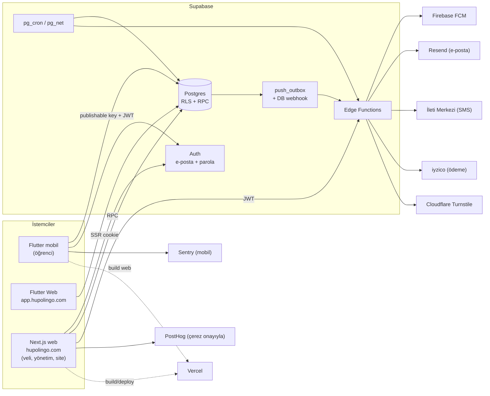
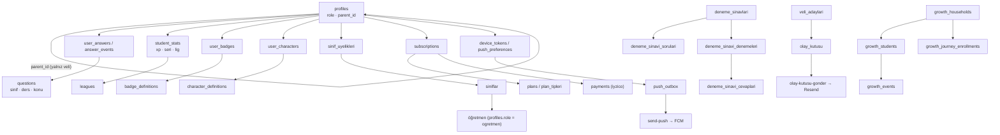

# Hupolingo — Proje Mimarisi (sıfırdan kurulum şablonu)

> **Amaç:** Bu depo, makine, hesaplar ve bu sohbet kaybolsa bile projeyi yeniden kurup geliştirebilmek için tek başvuru belgesidir.
> **Doğrulama tarihi:** 2026-10-16 · Dal: `master` · Son commit: `8898cd7` · 160 commit · Uzak depo: `github.com/ekonometrist61-create/hupo-classic`
> **Kaynak:** Bu belge koddan çıkarıldı (migration'lar, edge function'lar, paket dosyaları, `.env.example`, `vercel.json`, `proxy.ts`). `MASTER_BRIEF.md` 28 Eylül 2026 tarihli ve eski; çelişirse bu belge ve `PROJE_GUNLUGU.md` esastır.
> **Sınır:** Canlı Supabase veritabanı bu belgede **doğrulanmadı**. Şema yalnızca migration zincirinden okundu. Canlıyla farkı görmek için `supabase db pull` veya `npm run db:status` kullanın.
> **Sır kuralı:** Bu belgede anahtar **değeri** yoktur, yalnızca **adları** vardır.

---

## 0. Yarın bu belgeyle sıfırdan başlamak için 10 satır

1. Depo: `git clone https://github.com/ekonometrist61-create/hupo-classic.git`. Kaynak kod burada. Hâlâ commit edilmemiş değişiklikler varsa önce onları bul (bkz. §13.1).
2. Kaybolabilecek ve git'te **olmayan** şeyler: `.env.local`, `.mcp.json`, `.claude/settings.local.json`, `kurtarilan/` (APK, `libapp.so`), Android imza anahtarı (bkz. §12).
3. Sırlar bulutta durur: Supabase secrets, Vercel env, Firebase servis hesabı, iyzico, İleti Merkezi, Resend, Turnstile. Değerleri ilgili panellerden yeniden al. Değerleri bu belgeye veya kod deposuna yazma.
4. Supabase projesi `ccozfrpnvyrnktpffkwo`. Veri bulutta. Proje yaşıyorsa veriler durur, sadece erişim gerekir.
5. Şema: `supabase link --project-ref ccozfrpnvyrnktpffkwo` → `npm run db:status` → gerekirse `npm run db:deploy`.
6. Web: `cd web-panel && npm i && npm run dev` (`.env.local` gerekli, şablon `.env.example`).
7. Mobil: Flutter kurulu olmalı. Yol ASCII olmalı (OneDrive/Türkçe karakterli yol derlemeyi bozar). `flutter pub get && flutter run`.
8. Doğrulama: §14 komutları.
9. Kurallar: `AGENTS.md`. Özellikle RLS, `SECURITY DEFINER` + `set search_path`, `revoke`/`grant` ve `service_role` sırrının asla istemciye girmemesi.
10. Ne yapıldığını ve kalanı görmek için: `PROJE_GUNLUGU.md`.

---

## 1. Ürün

**Hupolingo (Öğrenci Hazırlık)**: Türkiye'de ortaokul öğrencileri için çalıştırma ve motivasyon uygulaması. Matematik ağırlıklı, diğer derslerin soru bankası hazırlanıyor.

| Yüzey | Kullanıcı | Nerede | Teknoloji |
|---|---|---|---|
| Öğrenci uygulaması | Öğrenci (çocuk) | Android/iOS (mobil), `app.hupolingo.com` (Flutter Web) | Flutter, Riverpod |
| Veli paneli | Veli | `hupolingo.com/veli-paneli` | Next.js |
| Yönetim paneli | Yönetici, öğretmen | `hupolingo.com/yonetim` (giriş: `/yonetim-giris`) | Next.js |
| Halka açık site | Ziyaretçi, veli adayı | `hupolingo.com` (landing, SSS, yasal sayfalar, deneme sınavı ön kaydı) | Next.js + CMS |
| Backend | Hepsi | Supabase projesi | Postgres, Auth, Edge Functions, pg_cron |

**Çocuk güvenliği (değişmez kural):** Reklam kapalı, takip kapalı, konum yok, uygulama içi satın alma yok. Ödeme yalnızca veli panelinde yapılır. Öğrenci verisi veli onayı olmadan veli paneline düşmez. Kaynak: `AGENTS.md` §5.

---

## 2. Üst düzey mimari



**Temel ilke:** İstemci Supabase'e doğrudan konuşur. İş kuralları **veritabanında** (RPC + RLS) durur, istemcide değil. Next.js sunucusu ve Flutter aynı RPC'leri çağırır. Edge Function yalnızca dış servisle konuşması gereken veya gizli anahtar isteyen işler için vardır.

---

## 3. Teknoloji yığını

| Katman | Teknoloji | Sürüm / not | Kaynak |
|---|---|---|---|
| Mobil dili/çatı | Flutter, Dart | SDK `>=3.5.0 <4.0.0` | `mobile-app/pubspec.yaml` |
| Mobil durum | flutter_riverpod | ^2.4.10 | pubspec |
| Mobil backend istemcisi | supabase_flutter | ^2.17.2 | pubspec |
| Mobil güvenli depo | flutter_secure_storage | ^9.2.4 (JWT Keychain/Keystore) | pubspec |
| Mobil animasyon/ses | lottie ^3.6.1, audioplayers ^6.1.0 | | pubspec |
| Mobil hata raporu | sentry_flutter | 10.0.0 (DSN yoksa kapalı) | pubspec |
| Mobil yazı tipi | Nunito, Lexend (SIL OFL) | `assets/fonts/` | pubspec |
| Web çatı | Next.js | ^16.3.4 (App Router) | `web-panel/package.json` |
| Web arayüz | React 19, Tailwind v4, framer-motion, lucide-react, recharts | | package.json |
| Web i18n | next-intl ^4.14.2 | `localePrefix: "never"`, birincil dil `tr` | AGENTS.md §4 |
| Web Supabase | @supabase/ssr ^0.7.0, supabase-js ^2.90.0 | Cookie tabanlı oturum | package.json |
| Web analitik | posthog-js 1.434.12 | Çerez onayı olmadan yüklenmez | `AnalyticsProvider.tsx` |
| Web CSV | papaparse | Toplu soru içe aktarma | package.json |
| Web test | Playwright (`e2e/`), ESLint 9, TypeScript 5.9 | | package.json |
| Veritabanı | Supabase Postgres | 105 migration, ~118 tablo, ~306 fonksiyon | `supabase/migrations/` |
| Sunucusuz | Supabase Edge Functions (Deno) | 7 fonksiyon + `_shared` | `supabase/functions/` |
| Zamanlanmış iş | pg_cron + pg_net | Süre kapatma (dakika), kimlik tespiti, olay kutusu (5 dk) | migration'lar |
| Ödeme | iyzico Checkout Form | Sandbox varsayılan | `supabase/docs/ODEME_KURULUM.md` |
| Push | Firebase Cloud Messaging HTTP v1 | Firebase paketleri henüz `pubspec`'te yok (bkz. §13) | `send-push` |
| E-posta | Resend | Veli sonuç bildirimi | `olay-kutusu-gonder` |
| SMS | İleti Merkezi | Veli telefon doğrulaması | `telefon-kod-gonder` |
| Bot koruması | Cloudflare Turnstile | Herkese açık formlar, fail-closed | `_shared/guvenlik.ts` |
| Barındırma | Vercel (web ve mobil web), Supabase (veri) | Netlify kullanılmıyor | `CLAUDE.md`, `mobile-app/vercel.json` |
| CI | GitHub Actions | Günlük yedek (03:30 TR) | `.github/workflows/yedek.yml` |
| Yedek hedefi | Google Drive (AES-256 şifreli) | Kod hazır, canlıda henüz çalıştırılmadı | `docs/yedekleme/KURULUM.md` |

---

## 4. Depo yapısı

```
hupo/                              (tek kök git deposu)
├── AGENTS.md                      Ajan ve geliştirici kuralları (ÖNCE OKU)
├── CLAUDE.md                      Claude Code talimatları
├── MASTER_BRIEF.md                Eski durum notu (28 Eylül) — kısmen geçersiz
├── PROJE_GUNLUGU.md                       Yapılanlar ve açık işler (güncel takip)
├── README.md                      Hızlı başlangıç
├── package.json                   Kök: yalnızca Supabase CLI ve db:* komutları
├── .github/workflows/yedek.yml    Günlük veritabanı yedeği
├── .claude/                       Claude ayarları, proje agent'ı, beş proje skill'i
├── docs/
│   ├── MIMARI.md                  ← bu belge
│   ├── YAYIN_DENETIMI.md          Yayın öncesi kontrol listesi (durum tablosu)
│   ├── hupo-design-growth/        Tasarım/UX/büyüme belgeleri (PROJECT_CONTEXT.md dahil)
│   ├── growth-crm/                CRM/CDP planı (6 faz, REUSE/EXTEND/CREATE haritası)
│   ├── mobil-yeniden-tasarim/     Mobil arayüz planı
│   ├── kelime-evreni/, splash/, yedekleme/
│   └── arsiv/                     git dışı; eski notlar (272 dosya)
├── supabase/
│   ├── config.toml                Yerel Supabase ayarları (yerel ortam; canlı ayar ayrı)
│   ├── migrations/                105 SQL dosyası, sıralı (YYYYMMDDHHMMSS_ad.sql)
│   ├── functions/                 7 Edge Function + _shared/
│   ├── tests/                     SQL testleri, alt klasörler: musteri_360, kelime_evreni, bildirim_kampanya, arsiv
│   ├── docs/ODEME_KURULUM.md      iyzico kurulumu
│   └── KURTARMA_DURUMU.md         Kurtarılan nesnelerin canlıyla karşılaştırması
├── mobile-app/
│   ├── lib/                       Flutter kaynağı (bkz. §6)
│   ├── assets/                    Hupo PNG, Lottie, ses, karakter görselleri, fontlar
│   ├── test/                      Widget ve birim testleri
│   ├── store/                     Mağaza formu taslakları (veri güvenliği vb.)
│   └── vercel.json                Flutter Web derlemesi (Vercel), güvenlik başlıkları
├── web-panel/
│   ├── src/app/[locale]/          Rotalar (bkz. §7)
│   ├── src/components/            Bileşenler (alanlara göre)
│   ├── src/lib/                   Yasal içerik, bakım, demo, CMS yardımcıları
│   ├── src/i18n/                  next-intl yapılandırması, CMS birleştirme
│   ├── src/messages/              tr.json / en.json (her yeni metin ikisine de)
│   ├── src/proxy.ts               Yönlendirme, oturum, bakım ve giriş kapıları
│   ├── scripts/sync-karakterler.mjs  predev/prebuild: karakter görsellerini eşitler
│   ├── e2e/                       Playwright testleri
│   └── public/characters/         Karakter görselleri (prompt dosyaları hariç)
├── soru-bankasi/                  Ders bazlı soru bankası (Markdown kaynak, sınıf klasörleri)
├── tools/                         Yardımcı betikler (bkz. §10.4)
└── kurtarilan/                    git DIŞI. APK, libapp.so, metin dökümleri (kurtarma kanıtı)
```

---

## 5. Veri katmanı (Supabase / Postgres)

### 5.1 Migration kuralları

- Dosya adı: `YYYYMMDDHHMMSS_kisa_ad.sql`. Sıra önemli. Tablo migration'ları RPC migration'larından önce gelir (ör. `…000010` tablolar, `…000020` RPC).
- Uzak veritabanı yalnızca `db push` ile değişir. Docker gerekmez. `npm run db:status`, `db:preview` (dry-run), `db:deploy`.
- Yeni tablo: `enable row level security` ve açık politika zorunlu.
- Her RPC için `revoke … from public, anon` ve gerekiyorsa `grant … to authenticated` migration içinde olmalı.
- `SECURITY DEFINER` her zaman `set search_path = ''` (veya `public, pg_temp`) ile.
- `service_role` fonksiyonları `anon` ve `authenticated`'dan revoke edilir.

Örnek kalıp (`AGENTS.md` §4):

```sql
create or replace function public.ornek(p_x uuid)
returns jsonb
language plpgsql
security definer
set search_path = public, pg_temp
as $$
begin
  if auth.uid() is null then raise exception 'Oturum bulunamadı'; end if;
  …
end;
$$;
revoke execute on function public.ornek(uuid) from public, anon;
grant  execute on function public.ornek(uuid) to authenticated;
```

### 5.2 Tablo grupları (118 tablo, gruplara ayrılmış)

| Grup | Tablolar (örnek) | Notlar |
|---|---|---|
| Kimlik ve profil | `profiles`, `consents`, `iletisim_tercihleri`, `iletisim_tercih_gecmisi`, `identity_merge_log`, `identity_merge_candidates` | `profiles.role`: `ogrenci`, `veli`, `ogretmen`, `admin` (check kısıtı) |
| Soru ve cevap | `questions`, `question_reports`, `question_revisions`, `question_bookmarks`, `user_answers`, `answer_events` | Soru bankasında `sinif` zorunlu |
| İlerleme ve oyunlaştırma | `student_stats`, `xp_events`, `leagues`, `karakter_lig_carpanlari`, `badge_definitions`, `user_badges`, `quest_definitions`, `quest_claims`, `character_definitions`, `user_characters` | XP, seri, lig, rozet, görev, karakter koleksiyonu |
| Günlük ve özel oyunlar | `daily_challenges`, `daily_challenge_completions`, `carpim_sifreleri`, `carpim_ilerleme`, `carpim_deneme_log`, `meydan_okumalar`, `meydan_okuma_cevaplar` | Günün 5 sorusu, çarpım şifreleri, meydan okuma |
| Kelime Evreni | `kelime_anlamlari`, `kelime_iliskileri`, `kelime_sorulari`, `kelime_denemeleri`, `kelime_ustaliklari`, `kelime_kaydedilenler` | Eş/zıt/eş sesli oyunları |
| Sınıf ve öğretmen | `siniflar`, `sinif_uyelikleri`, `grade_changes` | Öğretmen–sınıf eşleşmesi |
| Veli–öğrenci bağı | `parent_link_codes`, `parent_link_attempts`, `ogrenci_baglanti_kodlari`, `veli_baglama_hatalari`, `growth_household_izinleri` | Eşleştirme kodu, hız sınırı |
| Telefon doğrulama | `telefon_dogrulama_kodlari` (RLS açık, politikasız) | Kod salt+hash, 10 dk'da 3 kod, 5 yanlış denemede kilit |
| Deneme sınavı | `deneme_sinavlari`, `deneme_sinavi_sorulari`, `deneme_sinavi_denemeleri`, `deneme_sinavi_katilimlari`, `deneme_sinavi_cevaplari`, `deneme_donemleri`, `deneme_sinavi_on_kayitlari`, `deneme_on_kayit_izin_logu` | Herkese açık ön kayıt, süre dolunca otomatik kapanış |
| Ödeme ve plan | `plans`, `plan_tipleri`, `subscriptions`, `payments`, `coupons`, `coupon_redemptions`, `coupon_attempts`, `campaigns`, `app_settings` | Tutar sunucudan okunur, istemciden alınmaz |
| Bildirim | `notifications`, `device_tokens`, `push_preferences`, `push_outbox`, `duyurular` | Outbox deseni |
| Veli adayı ve CRM | `veli_adaylari`, `olay_kutusu`, `segmentler`, `iletisim_kampanyalari`, `iletisim_ayarlari`, `otomasyonlar`, `destek_gorevleri`, `anketler`, `anket_yanitlari`, `anket_katilimlari` | Olay kutusu → e-posta işçisi |
| Büyüme (growth) | ~40 `growth_*` tablo: `growth_households`, `growth_students`, `growth_events`, `growth_journeys`, `growth_campaigns`, `growth_leads`, `growth_prospects`, `growth_prospect_*`, `growth_subscription_projection`, `growth_financial_transactions`… | CRM/CDP katmanı, `docs/growth-crm/` |
| Operasyon | `admin_audit_log`, `rate_limit_hits`, `site_icerik` | Denetim izi, hız sınırı, CMS. Bakım yüzeyleri `20261033000100_bakim_yuzeyleri` migration'ında |

### 5.3 İlişki haritası



Tam şema dökümü: `supabase db pull`, ardından `supabase/migrations/` içinde son durum. Dökümü `supabase/KURTARMA_DURUMU.md` ile karşılaştırın.

### 5.4 Önemli RPC ailesi (istemcinin çağırdıkları)

| Alan | Örnek RPC'ler |
|---|---|
| Soru | `submit_answer` (idempotent, 20261006020000), `report_question`, `get_daily_challenge`, `complete_daily_challenge` |
| İlerleme | `award_xp_and_streak`, `get_child_topic_progress`, `get_app_config` |
| Sınıf | `get_supported_grades`, `set_my_grade` |
| Çarpım şifreleri | `get_carpim_sifreleri`, `get_carpim_sifre_detay`, `submit_cipher_answer`, `complete_cipher_stage`, `report_taught_friend` |
| Bookmark | `toggle_bookmark`, `list_bookmarks`, `kayitli sorular` RPC'leri |
| Veli | `veli_bagla_*` (hız sınırlı), veli paneli okuma RPC'leri. `veli_adayi_*` yalnız servis rolüne açık |
| Deneme | Ön kayıt, başlat/teslim RPC'leri, `deneme_sure_dolanlari_kapat()` (her dakika, pg_cron) |
| Ödeme | `payments-checkout` / `payments-callback` akışındaki yazma RPC'leri |
| Yönetim | `is_admin()`, `require_admin()`, `admin_*` RPC'leri (soru, kupon, kampanya, karakter, bildirim, ayarlar) |
| Büyüme | `growth_*` RPC'leri (CRM, pazarlama, analitik) |

---

## 6. Mobil uygulama (Flutter)

### 6.1 Klasör sorumlulukları (`mobile-app/lib/`)

| Klasör | Sorumluluk | Örnek dosyalar |
|---|---|---|
| `main.dart` | Başlatma: Sentry → Supabase → SharedPreferences → ses ön yükleme → `ProviderScope` | `main.dart` |
| `config/` | `Env` (`--dart-define`): Supabase URL, publishable key, web adresleri, Sentry DSN | `env.dart` |
| `auth/` | Giriş, kayıt, ortak kapı | `login.dart`, `signup.dart`, `auth_widgets.dart` |
| `providers/` | Riverpod sağlayıcıları (ağ istekleri `FutureProvider`, `keepAlive` bilinçli) | `app_providers.dart`, `kelime_providers.dart` |
| `models/` | `.fromMap` fabrikalı veri sınıfları | `models.dart`, `cipher_models.dart`, `league_models.dart`, `mock_exam_models.dart` … |
| `services/` | Repository'ler (RPC çağrıları), ses, push, hata raporu, güvenli depo | `quiz_repository.dart`, `kelime_repository.dart`, `push/`, `audio/`, `secure_storage.dart` |
| `screens/` | Ekranlar | `home_screen.dart`, `quiz_screen.dart`, `result_screen.dart`, `daily_challenge_screen.dart`, `review_screen.dart`, `cipher/`, `kelime/`, `mock_exam_screen.dart`, `league_screen.dart`, `arena_screen.dart`, `parent_link_screen.dart`, `profile_screen.dart`, `settings_screen.dart` |
| `widgets/` | Yeniden kullanılan bileşenler | `character/`, `evolving_avatar/`, `hupo/`, `splash/`, `survey/`, `ui/` (chunky_button, game_card, hero_header…), `veli/` |
| `theme/` | Tema, tokenlar (sabit renk yasak) | `app_theme.dart` |
| `settings/` | Erişilebilirlik ayarları (yazı boyutu, hareketi azalt, yazı tipi) | `app_settings.dart` |
| `ads/` | Öğrenci banner (ŞU AN BOZUK, bkz. §13) | `student_banner_ad.dart` |
| `content/` | Gizlilik bildirimi ve cevap geri bildirimi metinleri | `privacy_notice.dart` |
| `utils/` | Yardımcılar: breakpoints, biçimlendirme, haptik, hareket | |

### 6.2 Uygulama akışı

1. `SplashGate` → `AuthGate` (oturum var mı?) → giriş/kayıt.
2. Giriş sonrası `RootShell` (ana gezinme kabuğu; sekmeler kodda `root_shell.dart` içinde).
3. `MaintenanceGate` her ekranın üstünde: bakım modu ve minimum sürüm kontrolü `get_app_config` ile (yapılandırma hatasında bilerek açık kalır, fail-open).
4. `PushHost` bildirim izni ve yönlendirme. Yalnızca mobil ve yapılandırılmışsa etkin.

### 6.3 Mobil kuralları (`AGENTS.md` §4, §6)

- Hata durumu her zaman kullanıcıya gösterilir. `catch (_) {}` yasak.
- Metinler `const String`. Birebir korunacak 153 metin: `kurtarilan/missing-turkish.txt`.
- Yeni özellik kontrol listesi: model → repository (`supabase.rpc`) → provider → widget → ekran → migration (revoke/grant) → test.
- Paket eklerken `--dart-define` gerektirip gerektirmediğine bak.

---

## 7. Web (Next.js)

### 7.1 Rota grupları (`web-panel/src/app/[locale]/`)

| Grup | Yollar | Erişim |
|---|---|---|
| `(full-width-pages)` | `/gizlilik`, `/kosullar`, `/ticari-ileti-izni`, `/iletisim-izni`, `/demo`, `/deneme-sinavi-kayit`, `/deneme-sonuclari/[examId]`, `/bakim`, `/veli-paneli/giris`, `/veli-paneli/kayit`, `/yonetim-giris`, `/sifre-unuttum`, `/sifre-yeni`, hata sayfaları | Herkese açık |
| `(admin)/veli-paneli` | `aktivite`, `basarilar`, `denemeler`, `dersler`, `hedefler`, `tekrar`, `uyelik` | Veli oturumu (`proxy.ts`) |
| `(admin)/yonetim` | ~50 modül: sorular, sınıflar, kullanıcılar, deneme sınavları, karakterler, ligler, rozetler, duyurular, anketler, kampanyalar, kuponlar, planlar, ödemeler, CRM (veli adayları, potansiyel adaylar, müşteri 360, satış hattı, görevler), otomasyonlar, segmentler, kelime evreni, site içeriği, bakım/ayarlar | Yönetici (layout'ta rol kontrolü) |
| `(student)/ogrenci` | `/ogrenci`, `/soru`, `/gelisim`, `/deneme` | Öğrenci (web); ana öğrenci ürünü Flutter. Bkz. §13 |

### 7.2 İstek akışı (`proxy.ts`)

1. `next-intl` yerel yönlendirme (`localePrefix: "never"`).
2. Supabase oturum cookie yenileme (`utils/supabase/proxy.ts`).
3. Eski adreslerin kalıcı yönlendirmesi (`/signin` → `/veli-paneli/giris`, `/signup` → `/veli-paneli/kayit`), 308.
4. **Bakım kapısı:** `bakimDurumunuOku()` ile yüzeye göre (`site`, `veli`, `yonetim`…). Kapalıysa `bakim` sayfasına rewrite, `Retry-After: 300`. Yönetici `yonetim` yüzeyinde geçebilir.
5. **Giriş kapısı:** `/yonetim/*` → `/yonetim-giris`, `/veli-paneli/*` (giriş sayfaları hariç) → `/veli-paneli/giris`, `?next=` ile dönüş. Rol kontrolü proxy'de değil, giriş sayfasında ve bölüm layout'unda.
6. `DEMO_MODE` (`lib/demo-mode.ts`) üretimde asla açılmaz.

### 7.3 Bileşen ve veri desenleri

- Sunucu bileşeninde Supabase çağrısı; istemcide yalnız publishable key. Secret key web'e girmez.
- Metinler: `getTranslations` (sunucu), `useTranslations` (istemci). Yeni metin **hem** `tr.json` **hem** `en.json`.
- **CMS:** `site_icerik` tablosundaki satırlar `src/i18n/request.ts` içinde JSON mesajlarının üstüne birleştirilir. JSON yedek (fallback). `revalidate = 60` (ISR).
- **Yasal metinler:** `src/lib/legal/content.ts` (taslak, avukat onayı bekliyor).
- **Karakterler:** `predev`/`prebuild` script'i `sync-karakterler.mjs` ile `public/characters` altını eşitler.
- **Analitik:** `AnalyticsProvider` anahtar yoksa tamamen kapalı; yalnız çerez onayıyla yükler.
- **Form güvenliği:** Turnstile widget (`components/guvenlik/TurnstileWidget.tsx`) + sunucuda doğrulama.

---

## 8. Edge Functions ve dış servisler

| Fonksiyon | JWT | Ne yapar | Tetikleyen | Gerekli sırlar (adları) |
|---|---|---|---|---|
| `deneme-on-kayit` | Kapalı (herkese açık) | Deneme sınavı ön kaydı | Web formu | `CAPTCHA_SECRET`, `SKIP_CAPTCHA` (yalnız geliştirme) |
| `veli-adayi-kayit` | Kapalı | Erken erişim / veli adayı kaydı | Site formu | `CAPTCHA_SECRET` |
| `payments-checkout` | **Açık** (kullanıcı JWT) | Bekleyen ödeme oluşturur, iyzico Checkout Form açar | Veli paneli | `IYZICO_API_KEY`, `IYZICO_SECRET_KEY`, `IYZICO_BASE_URL` (varsayılan sandbox), `WEB_PANEL_URL` |
| `payments-callback` | Kapalı (iyzico tarayıcıyı yönlendirir) | Token'ı alır, sonucu iyzico'dan **sunucudan** sorgular, aboneliği açar | iyzico | Aynı iyzico sırları |
| `telefon-kod-gonder` | **Açık** | 6 haneli kodu SMS ile gönderir (fail-closed, yapılandırılmadan 503) | Veli paneli | `ILETIMERKEZI_KEY`, `ILETIMERKEZI_HASH`, `ILETIMERKEZI_SENDER` |
| `send-push` | Webhook | `push_outbox` INSERT → FCM HTTP v1 | DB webhook | `FIREBASE_SERVICE_ACCOUNT`, `PUSH_WEBHOOK_SECRET` |
| `olay-kutusu-gonder` | Kapalı (`--no-verify-jwt`) | Veliye sonuç e-postası | pg_cron (5 dk, pg_net) | `RESEND_API_KEY`, `OLAY_WORKER_SECRET` |
| `_shared/` | — | Turnstile doğrulama (`guvenlik.ts`), IP hız sınırı (`rate_limit_kontrol`), iyzico istemcisi (`iyzico.ts`, testli) | Diğer fonksiyonlar | `CAPTCHA_SECRET` |

Otomatik gelenler (kod yazılmaz): `SUPABASE_URL`, `SUPABASE_ANON_KEY`, `SUPABASE_SERVICE_ROLE_KEY`.

**Kural:** Gizli anahtar kodda, `.env` dosyasında commit'lenmiş dosyada veya log'da olmaz. Supabase'de `supabase secrets set NAME=…` ile girilir.

---

## 9. Temel akışlar (sıralı)

**9.1 Soru çözme (öğrenci, mobil)**
`quiz_screen` → `quiz_repository` → RPC `submit_answer` (idempotent; aynı istek iki kez gelirse tek kayıt) → `user_answers` / `answer_events` → XP, seri, lig ve rozet güncellemesi (`award_xp_and_streak` ve ilgili migration'lar) → sonuç ekranı. Kaydedilemezse sonuç sayfasında uyarı.

**9.2 Veli bağlama**
Öğrenci/veli eşleştirme kodu ile bağlanır (`parent_link_codes`). Deneme sayısı hız sınırına tabidir (`veli_bagla_rate_limit`). Veri görünürlüğü veli onayına bağlıdır (`riza` kapısı, migration `20261013000000_veli_riza_kapisi`).

**9.3 Telefon doğrulaması (veli, zorunlu — karar 2026-10-15)**
Web veli girişi → `telefon-kod-gonder` → RPC `telefon_kod_uret` (tekillik: aynı doğrulanmış numara iki veliye ait olamaz; 10 dk'da 3 kod) → SMS → `telefon_kod_dogrula` (5 dk, 5 yanlış deneme). **Web OTP arayüzü henüz yok** (bkz. §13).

**9.4 Ödeme (veli, web)**
Veli `/veli-paneli/uyelik` → `payments-checkout` (JWT, tutar `plans`'tan) → `payments` kaydı `bekliyor` → iyzico Checkout Form (kart bilgisi iyzico'da) → iyzico `payments-callback`'e POST → sunucudan `retrieve` → tutar eşleşirse `subscriptions` aktif → panele dönüş. Tekrar çağrı güvenlidir. Abonelik tek seferliktir (örneğin 30 gün), otomatik yenileme yoktur.

**9.5 Bildirim (push)**
Bir olay → `push_outbox` INSERT → DB webhook → `send-push` (`x-webhook-secret` doğrulaması) → FCM v1 → cihaz. Tercihler `push_preferences`. Web Push henüz yok.

**9.6 Deneme sınavı**
Yönetici `deneme_sinavlari` oluşturur, sorular atanır. Herkese açık ön kayıt (`deneme-on-kayit`, Turnstile + IP sınırı). Öğrenci sınava girer (`start` tekrar girişi reddeder). Süre dolunca `deneme_sure_dolanlari_kapat()` her dakika teslim eder (`otomatik`). Sonuç ilanı `deneme-sonuclari/[examId]` sayfasında. Çocukların herkese açık sıralamada görünmemesi bir **öneri**dir (KVKK, `PROJE_GUNLUGU.md` §452), henüz karara bağlanmadı.

**9.7 Veli sonuç e-postası**
Sonuç olayı `olay_kutusu`na düşer → pg_cron (5 dk) → `olay-kutusu-gonder` → Resend. Kilitleme ve yeniden deneme RPC'lerdedir.

**9.8 Parola sıfırlama**
Web `/sifre-unuttum` → e-posta bağlantısı → `/sifre-yeni` (PKCE `code` ve hash akışı). Mobil yalnız web'e yönlendirir (PKCE doğrulayıcısı mobilde eşleşmez). Supabase Auth URL ayarlarına bu iki adres eklenmeli (dış adım).

**9.9 Yedekleme**
GitHub Actions her gün 03:30 TR → `pg_dump` (postgres:17) → AES-256 → Google Drive, 30 gün saklama. Kurulum: `docs/yedekleme/KURULUM.md`.

---

## 10. Ortam, sırlar ve yapılandırma

### 10.1 Nerede durur?

| Ortam | Değişkenler (yalnız ad) | Nerede tutulur |
|---|---|---|
| Web (yerel) | `NEXT_PUBLIC_SUPABASE_URL`, `NEXT_PUBLIC_SUPABASE_PUBLISHABLE_KEY`, `NEXT_PUBLIC_POSTHOG_KEY`, `NEXT_PUBLIC_POSTHOG_HOST`, `SUPABASE_SECRET_KEY` (yalnız sunucu, gerekirse), `NEXT_PUBLIC_DEMO_MODE` (yalnız yerel) | `web-panel/.env.local` (git dışı). Şablon: `.env.example` |
| Web (Vercel) | Aynı ad listesi (üretim değerleri) | Vercel panelinde (proje bağlı: `web-panel/.vercel`) |
| Mobil derleme | `SUPABASE_URL`, `SUPABASE_PUBLISHABLE_KEY`, `WEB_BASE_URL` (varsayılan `https://hupolingo.com`), `APP_WEB_URL` (varsayılan `https://app.hupolingo.com`), `SENTRY_DSN` | `flutter run/build --dart-define=…`; web derlemesi Vercel'de `SENTRY_DSN` ortam değişkeni ile |
| Edge Functions | §8 tablosundaki adlar | `supabase secrets set` (Supabase projesi) |
| Android imza | `key.properties`, `*.jks` | Yerel, git dışı. **Diskte bulunamadı** (bkz. §12) |
| Google Drive yedek | OAuth istemcisi ve yenileme jetonu | GitHub Actions gizli değişkenleri ve yerel (`docs/yedekleme/KURULUM.md`) |
| Claude/MCP | `.mcp.json` (git dışı), `.claude/settings.local.json` (git dışı) | Yerel |

### 10.2 Herkese açık olabilecekler (sır değil)

- Supabase URL ve publishable (anon) key. Mobil kodda varsayılan olarak yazılı; RLS ile korunur.
- Sentry DSN, PostHog proje anahtarı. Proje başına bağlıdır ama gizli değildir.

### 10.3 Asla

- `service_role` / `sb_secret_…` anahtarı istemciye, `pubspec.yaml`'a, `.env.local`'e commit edilmiş dosyaya veya log'a yazılmaz.
- PII (ad, e-posta, telefon) log'a yazılmaz. Sentry olayları kişisel veri taşımaz.

### 10.4 Yardımcı betikler (`tools/`)

| Betik | İş |
|---|---|
| `serve.ps1`, `serve-mobile.ps1` | Yerel sunucu (web ve Flutter web) |
| `dart-statik-denetim.mjs` | Dart parantez/import kontrolü |
| `sql-sozdizim-denetimi.mjs` | Migration SQL sözdizimi |
| `istemci-rpc-denetimi.ps1` | İstemcinin çağırdığı RPC'lerin veritabanında var olup olmadığı |
| `soru_bankasi_sql.mjs`, `soru_bankasi_sql_tum_siniflar.mjs` | `soru-bankasi/` Markdown'ını SQL'e çevirir |
| `telefon-kod-test.mjs` | SMS akışı test betiği |
| `yedek/drive-yukle.mjs` | Yedeği Google Drive'a yükler |

---

## 11. Kurulum (sıfırdan, sırayla)

**Ön koşullar:** Git, Node.js (LTS), Flutter (Dart ≥3.5), Supabase CLI (`npm i` kökte devDependency), Vercel CLI (isteğe bağlı), Android Studio + SDK (Android derlemesi için), Docker (yalnız yerel Supabase için; uzak için gerekmez).

1. **Depoyu al:** `git clone` → kök dizinde `npm i`.
2. **Supabase projesi:** Yeni proje veya mevcut `ccozfrpnvyrnktpffkwo`. Auth → URL ayarları: site adresi, `/sifre-yeni`, `/sifre-unuttum`. Auth → e-posta doğrulama ayarını kontrol et (PROJE_GUNLUGU: canlı ayar repodan doğrulanamıyor).
3. **Şema:** `supabase login` → `supabase link --project-ref <ref>` → `npm run db:preview` → `npm run db:deploy`. Sonra `npm run db:status`.
4. **Sırlar:** §8 tablosundaki her sırrı `supabase secrets set` ile gir. Değerler dış panellerden: iyzico, Resend, İleti Merkezi, Firebase servis hesabı, Turnstile.
5. **Edge Functions:** `supabase functions deploy <ad>`. JWT ayarı fonksiyon başlığındaki yoruma göre: `payments-callback`, `olay-kutusu-gonder` ve kamuya açık formlar (`deneme-on-kayit`, `veli-adayi-kayit`) `--no-verify-jwt` ile; `payments-checkout` ve `telefon-kod-gonder` JWT açık kalır. Yanlış ayar güvenlik açığı veya çalışmayan çağrı demektir; deploy sonrası kontrol et.
6. **pg_cron ve DB webhook:** Migration'lar işi tanımlar. Dashboard'da `push_outbox` INSERT webhook'unun `send-push` fonksiyonuna bağlı olduğunu doğrula.
7. **Web:** `web-panel/.env.local` oluştur (`.env.example`'dan). `cd web-panel && npm i && npm run dev` → `http://localhost:3000/yonetim`. Sonra `npm run build` ve `npm run lint`.
8. **Vercel (web):** `web-panel/.vercel` bağlı proje. Ortam değişkenlerini Vercel'de tanımla. Alan adları: `hupolingo.com` (site ve panel), `app.hupolingo.com` (Flutter Web). Alt alan adı panel için kullanılmaz (bkz. memory: alan adı mimarisi).
9. **Mobil web (Vercel):** `mobile-app/vercel.json` derlemesi (`flutter build web --dart-define=SENTRY_DSN=…`). Flutter'ı klonlayarak kurar.
10. **Mobil uygulama:** ASCII yolda `flutter pub get` → `flutter run --dart-define=SENTRY_DSN=…`. Android: `google-services.json` ve (push için) Firebase paketleri (§13).
11. **Yedek:** `docs/yedekleme/KURULUM.md` §2 (Google Cloud, OAuth, "In production" yayını) ve GitHub Actions gizli değişkenleri. Kod hazır, canlı çalıştırma yapılmadı.
12. **Doğrulama:** §14.

---

## 12. Neyi kaybederim? (risk tablosu)

| Varlık | Git'te mi? | Kaybolursa | Önlem |
|---|---|---|---|
| Kaynak kod | Evet (`hupo-classic`, uzak depo) | Uzaktan geri alınır | Commit ve push düzenli olsun. **Şu an 19 değişiklik commit edilmemiş** (§13) |
| `kurtarilan/` (APK, `libapp.so`, metin dökümleri) | Hayır (bilinçli) | Kurtarma kanıtı gider; tekrar üretilemez | Harici yedek (sürücü/bulut) |
| `.env.local`, `.mcp.json`, `.claude/settings.local.json` | Hayır | Yerel ayarlar gider; değerler sağlayıcı panellerinden yeniden alınır | Şifre yöneticisi |
| **Android imza anahtarı** (`*.jks`, `key.properties`) | Hayır | **Play Store'da güncelleme yapılamaz.** Diskte bulunamadı | Yerini bul, şifreli yedekle. Yoksa Play uygulama kimliği sorunu çıkar |
| Supabase veritabanı ve kullanıcılar | Hayır (bulut) | Proje yaşıyorsa veri durur; proje silinirse gider | Günlük yedek (§9.9) **canlıda henüz çalışmıyor**; Dashboard yedeklerini kontrol et |
| Supabase / Vercel / Firebase / iyzico / İleti Merkezi / Resend / Turnstile sırları | Hayır | Hesaplara giriş gerekir | Hesap sahibinin erişimi ve 2FA; şifre yöneticisi |
| `.claude/worktrees/` | Yerel | Eski geçici kopyalar; önemsiz | Gerekmez |

---

## 13. Bilinen durum, açıklar ve açık işler (2026-10-16)

### 13.1 Hemen

- **Commit edilmemiş çok sayıda değişiklik var.** Bu belge yazılırken `git status` 18 değiştirilmiş/takipsiz dosya gösterdi. Bunların bir kısmı: `PROJE_GUNLUGU.md`, `mobile-app/lib/services/quiz_repository.dart`, `mobile-app/lib/services/push/push_settings_card.dart`, `web-panel/src/components/auth/SignUpForm.tsx`, `web-panel/src/components/header/NotificationDropdown.tsx`, `web-panel/src/messages/{en,tr}.json`, takipsiz `supabase/functions/telefon-kod-gonder/`, migration'lar `20261034`–`20261037`, `supabase/tests/bildirim_kampanya/`, `tools/telefon-kod-test.mjs`. Uzak veritabanında telefon migration'ı uygulanmış ama dosyası git'te yok. **Bunları commit etmek en önemli koruma adımıdır.** Değişiklikleri kimin yaptığı bu belgede bilinmiyor; commit öncesi `git diff` ile gözden geçir.
- **Android imza anahtarı** diskte yok. Yerini bul.
- **Gizli anahtar rotasyonu:** `PROJE_GUNLUGU.md` §331'e göre Google API anahtarları (Gemini/Stitch) `9b4ee9c` commit'indeki `.claude/mcp.json` ve `.claude/settings.json` içindeydi. Güncel dosyalarda ham anahtar yok, ama **geçmiş commit'te duruyor**. Anahtarlar iptal edilip yenilenmeli.

### 13.2 Kodda eksik veya kırık

- **`ads/student_banner_ad.dart`** `google_mobile_ads` paketini import ediyor. Paket `pubspec.yaml`'da ve `pubspec.lock`'ta yok. Dosya hiçbir yerden import edilmediği için derlemede değil, `flutter analyze` hatasında görünür. Ya paketi ekle ya da dosyayı kaldır. Reklamlar uygulamada zaten kapalı.
- **Firebase** (`firebase_core`, `firebase_messaging`) `pubspec.yaml`'da yok. `push_backend_firebase.dart` var ama analiz dışında. Push şu an uçtan uca çalışmaz.
- **`flutter analyze`:** `YAYIN_DENETIMI.md`'ye göre 24 hata (değiştirilmeyen dosyalarda). Güncel durum tekrar ölçülmeli.
- **Veli telefon doğrulama arayüzü yok.** (Çalışma ağacında `telefon-kod-gonder` ve migration'lar var, web tarafı yok.) Migration ve SMS fonksiyonu hazır; web'de numara ve kod ekranı, doğrulanmamış veliyi yönlendiren kapı yok. İleti Merkezi sırları ayarlanmadan fonksiyon 503 döner.
- **Web'deki öğrenci sayfaları** (`(student)/ogrenci`) `redirect("/signin")` kullanıyor. `/signin` kalıcı olarak veli girişine gider. Öğrenci web yüzeyinin canlıda kullanılıp kullanılmadığı netleşmeli.
- **Yönetim bakım bypass'ı** (yönetici, bakım sırasında yönetim paneline girebilmeli) uçtan uca test edilmedi.
- **Yönetici MFA:** TOTP zorunluluğu planlı, henüz uygulanmadı (`PROJE_GUNLUGU.md` §356).
- **Yasal metinler** (`/gizlilik`, `/kosullar`, `/ticari-ileti-izni`): taslak. Şirket unvanı, iletişim, saklama süresi yer tutucu. Avukat onayı gerekli. Google Play'den önce kapanmalı.
- **Canlı Supabase ayarları:** e-posta doğrulama, sıfırlama URL'leri ve günlük yedek canlıda doğrulanmadı.
- **Telemetri:** Mobilde Sentry var (DSN'siz kapalı). Web'de hata raporlaması yok. PostHog çerez onayı akışı test edilmeli.

### 13.3 Ürün kararları bekleyenler

- Öğrenci onboarding akışı (`YAYIN_DENETIMI`: ❌).
- Öğretmen veli panelinde boş ekran: `PROJE_GUNLUGU.md`'de karara bağlandı, uygulanıp uygulanmadığı kontrol edilmeli.
- Deneme sınavı bireysel sıralama sınırı: öneri aşamasında (§9.6).
- Çevrimdışı mod ve bağlantı tespiti yok (`connectivity_plus` yok).
- Çocuk uygulamasının profilinde `hupolingo.com/premium` bağlantısı var. Mağaza politikasına uyumu kararı bekliyor (`YAYIN_DENETIMI.md`).

### 13.4 Tutarsızlık notları

- `MASTER_BRIEF.md` 28 Eylül durumunu anlatıyor ve OneDrive yolunu gösteriyor. Proje `C:\Dev\hupo` altında ve çok daha ileride. Bu belge ve `PROJE_GUNLUGU.md` güncel.
- `MASTER_BRIEF`'deki `proje-okulu-app/`, `reports/`, `research_notes/` klasörleri kök dizinde artık yok. Belgelerdeki bu referanslar eskidir.
- `supabase/config.toml` yerel ayarlardır, canlıyı değiştirmez.

---

## 14. Doğrulama komutları

```bash
# Veritabanı
npm run db:status                 # uzak ve yerel migration listesi
npm run db:preview                # push etmeden fark
supabase test db                  # supabase/tests/*.sql (yerel Docker gerekir)

# Web
cd web-panel
npm run lint
npx tsc --noEmit
npm run build
npm run test:e2e                  # Playwright (sunucu ayağa kalkmalı)

# Mobil (ASCII yolda)
cd mobile-app
flutter analyze                   # hedef: 0 hata
flutter test

# Depo denetimleri
node tools/sql-sozdizim-denetimi.mjs
node tools/dart-statik-denetim.mjs
```

Doğrulamalar yapılmadan tamamlandı denmez (`PROJE_GUNLUGU.md`, kural: "yalnız gerçekten tamamlanan işler kapatılır").

---

## 15. Kurallar özeti (ihlal edilmez)

1. Türkçe arayüz, Türkçe yorum; değişken ve alan adları `snake_case` (Supabase ile eşleşir); sınıf/dosya adları İngilizce konvansiyon.
2. Yeni RPC: `SECURITY DEFINER` + `set search_path` + `revoke`/`grant`. Yetki genişletilmez.
3. Yeni tablo: RLS açık, politika açık.
4. Ödeme tutarı istemciden alınmaz; `plans`'tan okunur.
5. Çocuk varsayılanları: reklam kapalı, takip kapalı, konum yok, uygulama içi satın alma yok.
6. Hata her zaman kullanıcıya gösterilir; sessiz yutma yok.
7. Bir değişiklikten önce hangi katmanı etkilediğini söyle (`supabase` → `mobile-app` / `web-panel` → ortak mesaj anahtarları).
8. Uydurma yok. Emin olunmayan yer `// TODO(kurtarma):` ile işaretlenir.
9. Tasarım ve metin işleri `hupo-design-growth-director` agent'ına, kodu sen yazma.
10. Sırlar yalnız `.env.local`, `.claude/settings.local.json`, ortam değişkenleri veya sağlayıcı panellerinde durur.

---

## 16. Hızlı sözlük

| Terim | Anlamı |
|---|---|
| Publishable / anon key | Tarayıcı ve mobilde kullanılan, RLS ile korunan genel anahtar |
| `service_role` / `sb_secret_` | Tam yetkili sır. Yalnız Edge Function ve sunucuda |
| RPC | Veritabanında `SECURITY DEFINER` fonksiyon, istemcinin çağırdığı arayüz |
| Outbox | Yazılan olayların sırayla dış servise gönderildiği tablo (`push_outbox`, `olay_kutusu`) |
| Yüzey (surface) | Bakım kapısının tek tek kontrol ettiği alan: `site`, `veli`, `yonetim` |
| Kapı (gate) | Giriş ve rol kontrolünün yapıldığı sayfa veya layout |
| Growth / CRM | Veli adayları, kampanyalar, otomasyonlar ve müşteri görünümü (`growth_*`) |
| Meydan okuma | İki öğrencinin karşılıklı kelime oyunu |
| Karakter | Öğrencinin açtığı, lig ve XP ile ilişkili koleksiyon kartı (`character_definitions`) |
